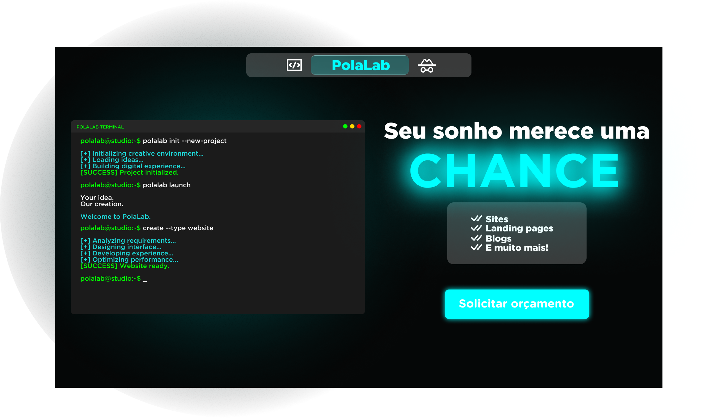
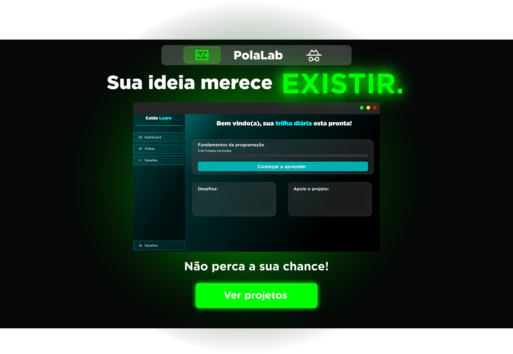
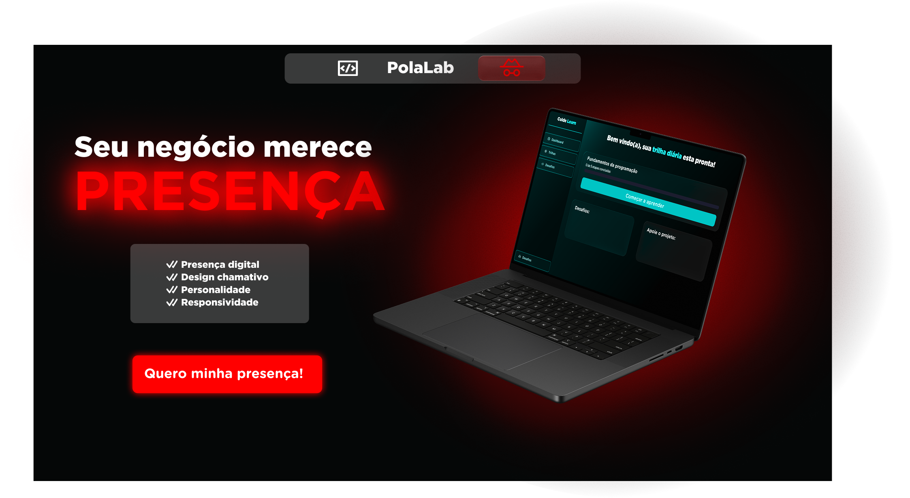

# Polaroid Portfolio

Projeto pra praticar criação e design de sites, simples site pra servir como portfólio pessoal.

## ✦ Sobre
Criado com o objetivo de mostrar minhas capacidades e formas de criar e dar um estilo mais moderno pra um site.

## ✦ Tecnologias
- HTML
- CSS
- JS

## ✦ Funcionalidades
- animações simples
- sombreamentos basicos
- flexbox

## ✦ Estrutura
pasta assets possui tudo do site como imagens, fontes e icones usados no site.

## ✦ Preview
Veja aqui como ficou e diga caso encontrar algum erro:(https://polalab.pages.dev)

## ✦ Objetivo
relembrar alguns conceitos de html e css, aprender grid, flexbox e afins.

## ✦ Autor
Polaroid
